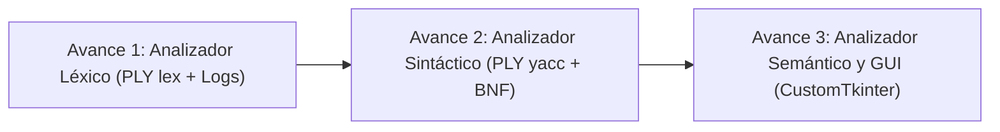

# Compilador para Subconjunto de Go (ESPOL)

Analizador Léxico, Sintáctico y Semántico para un subconjunto del lenguaje de programación **Go**, desarrollado en **Python 3** mediante la herramienta de análisis léxico y sintáctico **PLY (`ply.lex` y `ply.yacc`)**, complementado con una interfaz gráfica moderna e interactiva implementada en **CustomTkinter**.

Este proyecto corresponde al desarrollo práctico de la materia **Lenguajes de Programación** de la Escuela Superior Politécnica del Litoral (**ESPOL**), bajo la dirección del profesor Ing. Rodrigo Saraguro.

---

## 👥 Equipo de Desarrollo

| Integrante | Rol / Usuario GitHub | Módulos Asignados (Avance 1 - Léxico) |
| :--- | :--- | :--- |
| **Pablo Naranjo** | `@PabloNaranjoM` | Palabras reservadas `struct` y `map`, tipos numéricos (`int`, `float64`), literales flotantes (`LITERAL_FLOAT`), literales de cadena con secuencias de escape (`LITERAL_STRING`), asignación corta (`:=`), asignaciones compuestas (`+=`, `-=`, `*=`, `/=`, `%=`), incremento/decremento (`++`, `--`), comentarios (`//`, `/* */`), delimitadores (`:`, `;`, `&`), manejador de errores léxicos (`t_error`), función fábrica `build_lexer()` y exportador CLI de logs en `main.py`. Algoritmo de prueba: `algoritmos/algoritmo1.go`. |
| **Hivor Araujo** | `@AraujoHivor` | Palabras reservadas principales de Go (23 keywords: `package`, `import`, `func`, `var`, `const`, `return`, `if`, `else`, `for`, `range`, `switch`, `case`, `default`, `break`, `continue`, `fallthrough`, `type`, `interface`, `go`, `chan`, `select`, `defer`, `goto`), operadores aritméticos (`+`, `-`, `*`, `/`, `%`), asignación simple (`=`), delimitadores de agrupación (`()`, `{}`, `[]`), identificadores (`ID`), tipo predefinido `string` y literales enteros (`LITERAL_INT`). Algoritmo de prueba: `algoritmos/algoritmo2.go`. |
| **Josué Pacheco** | `@JosuePach3co` | Tipo predefinido `bool`, literales booleanos (`true`, `false`), operadores relacionales (`==`, `!=`, `<`, `>`, `<=`, `>=`), operadores lógicos (`&&`, `\|\|`, `!`), delimitadores (`.`, `,`), regla para descartar espacios en blanco y tabulaciones (`t_ignore`) y regla para seguimiento de saltos de línea (`t_newline`). Algoritmo de prueba: `algoritmos/algoritmo3.go`. |

---

## 🧭 Hoja de Ruta del Proyecto (Entregas por Avances)



1. **Avance 1: Analizador Léxico (Lexer)**
   - Especificación formal de tokens, literales y palabras clave de Go con `ply.lex`.
   - Recuperación ante errores léxicos (`t_error`) con conteo preciso de líneas.
   - Creación de algoritmos de validación (`algoritmo1.go`, `algoritmo2.go`, `algoritmo3.go`).
   - Generación automática de archivos de log unificados según el estándar docente.
2. **Avance 2: Analizador Sintáctico (Parser)**
   - Implementación de la gramática libre de contexto (BNF) con `ply.yacc`.
   - Manejo de precedencias y asociatividad de operadores.
   - Construcción de árboles de sintaxis abstracta (AST) y diagnóstico de errores sintácticos.
3. **Avance 3: Analizador Semántico e Interfaz de Usuario (GUI)**
   - Verificación de tipos estáticos, resolución de ámbitos (scopes) y tabla de símbolos.
   - Interfaz gráfica moderna en **CustomTkinter** con editor de código, resaltado de sintaxis, panel de tokens interactivo y visor de árbol de análisis.

---

## 📂 Arquitectura del Repositorio

La estructura del proyecto organiza la separación de responsabilidades para facilitar el trabajo colaborativo en equipo:

```text
LP-Proyecto_Parcial/
│
├── algoritmos/             # Casos de prueba escritos en el subconjunto de Go (.go)
│   ├── algoritmo1.go       # Algoritmo de validación - Pablo Naranjo
│   ├── algoritmo2.go       # Algoritmo de validación - Hivor Araujo
│   └── algoritmo3.go       # Algoritmo de validación - Josué Pacheco
│
├── logs/                   # Registros de ejecución generados por el analizador léxico
│   └── lexico-NombreApellido-DD-MM-YYYY-HHhMM.txt
│
├── src/                    # Código fuente del compilador en Python
│   ├── __init__.py
│   ├── lexer.py            # Analizador léxico implementado con PLY
│   ├── parser.py           # Analizador sintáctico con PLY (Avance 2)
│   ├── semantic.py         # Analizador semántico y tabla de símbolos (Avance 3)
│   └── gui.py              # Interfaz gráfica de usuario en CustomTkinter (Avance 3)
│
├── CONTRIBUTING.md         # Normas de Git, contrato de tokens y formato de commits
├── README.md               # Portada técnica y visión general del proyecto
├── main.py                 # Punto de entrada principal para CLI y ejecución
└── requirements.txt        # Dependencias externas del proyecto
```

---

## ⚙️ Preparación del Entorno de Desarrollo

Se requiere **Python 3.10** o superior instalado en el sistema.

### 1. Clonar el Repositorio
```powershell
git clone https://github.com/PabloNaranjoM/LP-Proyecto_Parcial.git
cd LP-Proyecto_Parcial
```

### 2. Creación y Activación del Entorno Virtual

#### En Windows (PowerShell):
```powershell
python -m venv venv
.\venv\Scripts\Activate.ps1
```

*(Si PowerShell bloquea la ejecución de scripts, ejecutar temporalmente: `Set-ExecutionPolicy -Scope Process -ExecutionPolicy Bypass`)*.

#### En Linux o macOS (Bash/Zsh):
```bash
python3 -m venv venv
source venv/bin/activate
```

### 3. Instalación de Dependencias
Con el entorno virtual activo, instale las librerías requeridas:
```bash
pip install -r requirements.txt
```

---

## 📖 Normas de Contribución y Contrato de Tokens

> [!IMPORTANT]
> **Lectura obligatoria para los desarrolladores:**
> Antes de realizar cualquier aporte o commit, consulte la guía técnica detallada en:
> 👉 **[CONTRIBUTING.md](./CONTRIBUTING.md)**
> 
> En dicho documento encontrará:
> - Configuración obligatoria de identidad en Git (`user.name` y `user.email`).
> - Política estricta de **Merge commit (`--no-ff`)** y prohibición de *Squash*.
> - **Tabla Contrato de Tokens**: Estandarización de identificadores en mayúsculas para encajar directamente con `ply.yacc`.
> - Estándar de nomenclatura para archivos de log (`lexico-NombreApellido-DD-MM-YYYY-HHhMM.txt`).
